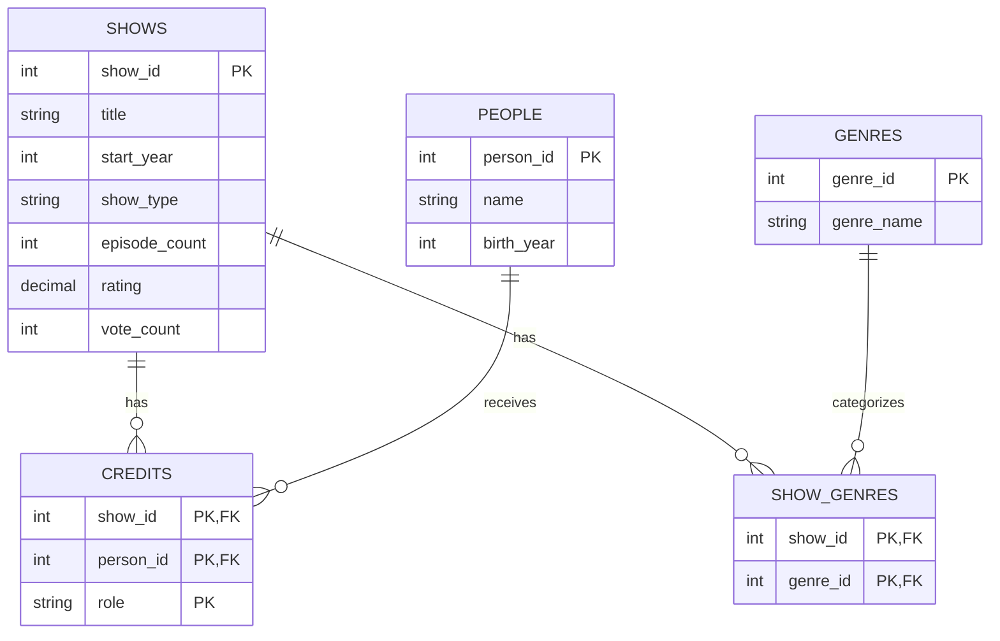

# TV Show Catalog Design

This design stores shows, people, genres, and the connections between them.

## Keys

- SHOWS: primary key is show_id.
- PEOPLE: primary key is person_id.
- GENRES: primary key is genre_id.
- SHOW_GENRES: composite primary key is (show_id, genre_id).
- CREDITS: composite primary key is (show_id, person_id, role).

## Foreign keys

- SHOW_GENRES.show_id references SHOWS.show_id.
- SHOW_GENRES.genre_id references GENRES.genre_id.
- CREDITS.show_id references SHOWS.show_id.
- CREDITS.person_id references PEOPLE.person_id.

## Assumptions

- Show titles and people's names can repeat, so each has a unique ID.
- A person can work on several shows.
- A show can have several stars and several writers.
- Each credit records one person's role on one show.
- The role is either "star" or "writer".
- A person can be both a star and a writer on the same show.
- A show can have several genres.
- A genre name is unique in GENRES.
- A show may initially have no credits or genres recorded.
- An unrated show has a NULL rating and zero votes.
- Only the current average rating and vote count are stored.
- Individual episodes and individual votes are outside this design.

## Comparison with the course design

- Both designs identify shows by an ID because titles can repeat.
- My CREDITS table combines stars and writers using a role column.
  Its composite primary key prevents duplicate credits for the same role.
- My GENRES table stores each genre name once. SHOW_GENRES connects
  shows to genres and prevents repeating the same show/genre pair.
- My rating and vote count are stored in SHOWS rather than in a
  separate RATINGS table. This allows only one current rating summary
  per show. A NULL rating represents an unrated show.